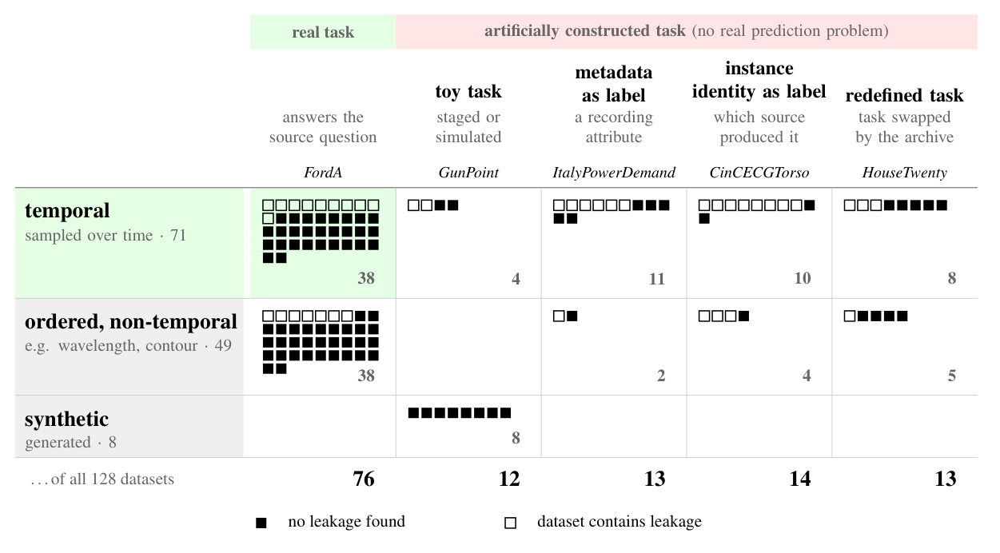

# UCR provenance audit

What do the 128 UCR datasets ask classifiers to predict, and what do their train/test splits test?
This audit traces their sources, tasks and split evidence. Released with
*Fifty-Two Shades of Pig: What the UCR Archive Really Asks Classifiers to Do* (NeurIPS 2026 workshop).

**Browse it:** https://automl.github.io/ucr-provenance-audit/

## Main findings

- **52 of 128 fail task construction:** staged or simulated demonstrations, recording attributes or source identities used as labels, or tasks redefined by the archive.
- **41 have a leakage concern:** 17 contain test series identical to training series; 24 more share a source across the split. The remaining verdicts are 63 **Unclear**, 9 **Separated**, 7 **Related periods** and 8 **Generated**.
- **Only 38 are real tasks on series sampled over time; 10 have a leakage concern.** The real-task group includes cases with undocumented label meaning.



Each square is a dataset: columns show the task, rows show whether the index is time, another ordered quantity or synthetic.
Datasets with multiple construction mechanisms appear once, under their label mechanism.
White means a leakage concern; black means none found, **not a verified clean split**: 51 of the 76 real-task datasets have Unclear splits.

## Files

| | |
|---|---|
| `ucr_provenance_audit.csv` | verdicts and evidence per dataset ([columns](COLUMNS.md)) |
| `records/` | full records with quoted sources ([schema](records/SCHEMA.md)) |
| `duplicates/` | exact test-in-train duplicate check and results |
| `protocols/` | drafting, review and fact-checking instructions, kept as used |

```python
import pandas as pd
audit = pd.read_csv("ucr_provenance_audit.csv")
audit[audit.task_construction == "fail"][["dataset", "benchmark_target", "source_target"]]
```

## How it was made

- Agents drafted each record from source publications; a second agent reviewed it.
- Claude Opus and GPT Astra independently re-derived every verdict and fact column from the records; a third agent reconciled their results.
- The authors decided every low-confidence verdict. They did not check each record in full.

If you find an error, please open an issue.

## Cite

```bibtex
@inproceedings{swelam2026fiftytwo,
  title     = {Fifty-Two Shades of Pig: What the {UCR} Archive Really Asks Classifiers to Do},
  author    = {Swelam, Omar and K{\"u}ken, Jaris and Hoo, Shi Bin and Hutter, Frank and Purucker, Lennart},
  booktitle = {NeurIPS 2026 Workshop on Foundation Models for Temporal Systems},
  year      = {2026}
}
```

Data under CC BY 4.0, code under MIT. The UCR data themselves are not included; the duplicate
script downloads them.
